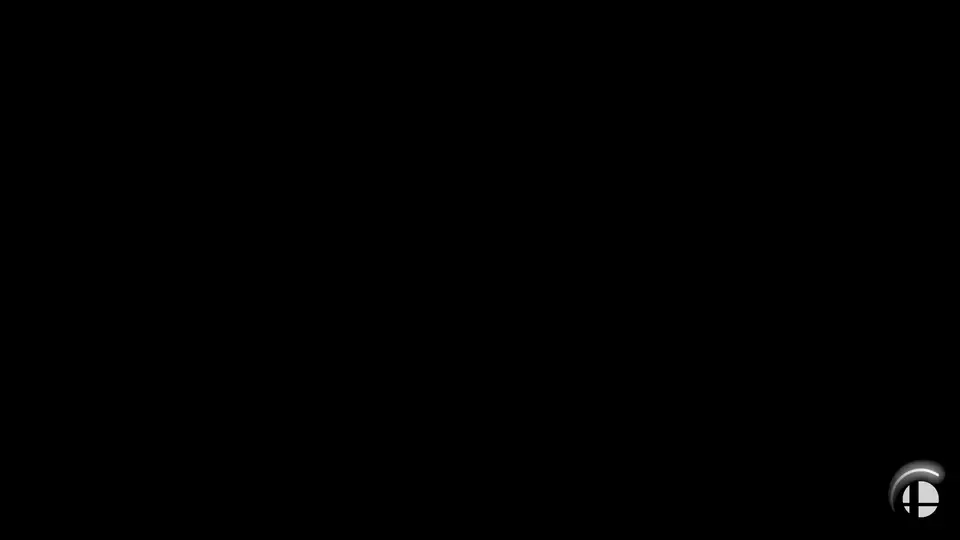

# ssbu-recomp

A **static recompilation** of *Super Smash Bros. Ultimate* (version 13.0.4) from the Nintendo Switch to a
native Windows x64 program, with its own runtime, a Vulkan renderer, and tools to turn the fighters' script
code back into readable, editable C++.

It is **not an emulator**: there is no CPU interpreter and no JIT. The game's AArch64 machine code is
translated to C ahead of time and compiled for the PC; the console's system libraries, graphics API, audio,
video, input and file system are re-implemented by this project's runtime.

> **This repository contains no game code, no game assets, no keys and no firmware.**
> You need your own legally obtained copy of the game (13.0.4). Everything derived from it is generated on
> your PC, from your dump, and never leaves it. The only game-related text in the tree is names: a list of
> system-library function names chosen for translation, and function names used by the tools.



## Status (October 2026)

Early, playable in parts, not finished. What is written here was measured on the development PC; where
something was not checked, it says so.

| Area | State |
|---|---|
| Boot → opening movie → title → menus | works |
| Smash (1v1 vs CPU), whole match to the results screen | works |
| Classic Mode, Training, Home-Run Contest | start and play (tested with scripted input only) |
| Spirits board and collection, Vault (sounds, replays, tips, shop), options, Mii Fighters | reachable |
| Adventure (World of Light) | intro reached; map and fights not tested |
| Team battles, Squad Strike, Tourney, 3-8 players, Stage Builder editing | not tested |
| Online | not available (the network services answer as an offline console) |
| Renderer | Vulkan by default, OpenGL as a fallback |
| Speed | 59-60 fps in a fight when nothing new has to be prepared; visible hitches the first time new content appears (shader/pipeline preparation is not complete) |
| Integrated GPU | a whole match runs on an Intel Raptor Lake iGPU at 59-60 fps outside those hitches |
| Controllers | any pad through SDL3 (database mapping, hot-plug, 8 players, remapping file, rumble, gyro) — passes its automated tests with virtual devices; **not yet confirmed with physical pads** |
| Save data | journalled like the console's (two-phase commit) |
| Mods | fighter scripts as readable C++ rebuilt in about a second; a hook table makes every function of the game and of the script modules replaceable from a mod DLL without rebuilding the game (self-tested; shown with two small edits) |
| Rollback netcode | planned, not started |
| Linux / Steam Deck | not started (the runtime is Windows-only today) |
| Building from a fresh clone | **verified** (October 2026): `python scripts/setup.py --dump <your dump> ...` builds a running game in about 45 minutes and passes the scripted match; see [BUILDING.md](BUILDING.md) |

## How it works

```
your dump ──► tools/extract ──► main executable, SDK, script modules, data
                 │
                 ▼
        tools/lifter (recomp.py)        AArch64 ─► C, one C function per game function
                 │                       checked against Unicorn on 32,043 instruction cases
                 ▼
        clang ─► game DLL  +  one DLL per script module
                 │
                 ▼
        runtime/                         what the console provided, re-implemented:
          hostrt, os_threads             loader, threads, memory, C++ exceptions through lifted code
          nn*.c                          ~1,100 system-library entry points (files, time, audio, input,
                                         movies, fonts, applets, accounts, network as "offline")
          nvn_vk*.c, nvn_gl.c            the console's graphics API (NVN) on Vulkan / OpenGL
          mx_translate.c                 the game's GPU shader machine code ─► GLSL ─► SPIR-V
          nnpad_sdl.c                    controllers through SDL3
```

Three layers, three different natures:

- **Game code** is recompiled, not emulated. It is a mechanical translation: complete and exact, but not
  readable source.
- **System calls** are re-implemented on Windows, the way Wine re-implements Windows calls. Part of the
  console's own library code (shipped inside the game) is lifted the same way as the game.
- **Graphics** are translated at the API level (not at the level of GPU hardware), and the shaders are
  translated when they are loaded.

### Readable source where people edit

A fighter's moves are small scripts. `fighter_sdk/tools` decompiles them mechanically into C++ like this
(generated on your PC from your dump; not stored in this repository):

```cpp
ACMD(mario, game_attack11) {
    frame(agent, 2);
    if (is_excute(agent)) {
        ATTACK(agent, 0, 0, hash40("top"), 2.2f, 361, 30, 0, 20, 1.2f, 0.0f, 6.3f, 6.0f, /* ... */);
    }
    wait(agent, 2);
    if (is_excute(agent)) {
        AttackModule::clear_all(boma);
        WorkModule::on_flag(boma, FIGHTER_STATUS_ATTACK_FLAG_ENABLE_COMBO);
    }
}
```

On the development PC the tool turns 80,880 of 84,886 animation-command scripts of all fighters (95%)
into source that behaves the same as the original in a differential test; a fighter rebuilds in about a
second and the game picks it up. The shared fighter state machine (dash, turn, air dodge, landing, cancel
rules) is being converted with a second, general decompiler.

## Features

- Native Windows x64 executable; no CPU emulation at run time
- Vulkan renderer (pipelines prepared on worker threads, driver cache on disk) and an OpenGL renderer
- Options in `config/graphics.ini`: renderer, window / borderless / fullscreen, size, vsync mode, GPU
  choice, anisotropic filtering, frame-time line (internal resolution scale: in progress)
- Any controller through SDL3; `config/controllers.ini` for remapping; `--pad-test` and `--pad-map`
- The game's own movies (VP9), audio (Opus) and fonts, decoded by the runtime
- Deterministic scripted input and recording/replay for testing
- An audit that classifies every system call handler as real / lifted / simplified, with a strict mode
  that stops the game the moment it calls something that is not really implemented

## Plans

1. Every mode playable from start to end, steady 60 fps (finish shader/pipeline preparation)
2. Internal resolution scale and a low-end profile
3. Mod platform: file overrides, the function hook API with a small C++ SDK, documentation
4. The shared fighter state machine as readable source (movement tech, cancel rules), so that changes to
   the battle system (wavedash, perfect pivot, a turbo mode) are ordinary mods; further out, new fighters,
   new modes, extra character slots and a larger character select screen
5. Rollback netcode with an own network layer: deterministic stepping, state snapshots, then the protocol
6. Verified build from a fresh clone; then other platforms

## Requirements

To run: Windows 10/11 x64, a GPU with a Vulkan 1.3 driver, your own dump of the game (version 13.0.4).

To build: Python 3.10+ (numpy, lz4, zstandard, Pillow, unicorn), LLVM/clang 9.0.0, MSVC Build Tools with a Windows SDK,
SDL3 (VC development package), Khronos Vulkan-Headers, glslang (Windows release), a yuzu-family source checkout for the
self-test reference data, and your dump. Exact versions, links and the one command: [BUILDING.md](BUILDING.md).

## Repository layout

| Folder | Contents |
|---|---|
| `runtime/` | the host runtime: loader, system libraries, graphics, audio, input |
| `tools/lifter/` | AArch64 → C recompiler, build scripts, differential tests |
| `tools/nro/` | the same for the game's script modules |
| `tools/extract/` | reading your dump |
| `tools/audit/` | the "what is really implemented" audit |
| `fighter_sdk/` | fighter script decompilers, the C++ SDK and runtime for fighter source, the hook API |
| `tests/` | scripted input sequences and measuring scripts |
| `docs/` | design notes |

## Related work

The matching decompilation that this project also contributes to is a separate effort based on
[sbergeron42/ssbu-decomp](https://github.com/sbergeron42/ssbu-decomp). Technique was learned from the
open-source emulators (yuzu and its successors), from SDL, from the N64 static-recompilation projects and
from other Switch recompilation and decompilation projects; names of script functions and constants come
from the Smash modding community's public work (param labels, skyline-smash, ARCropolis).

## How this was made

**This project was built with AI, and that is part of the point.**

I am not a reverse engineer or a security engineer, and I did not come up through whatever field normally
teaches this. Almost all of the code here was written by AI coding agents (Claude) that I direct: I decide
what to try, think up the angle of attack or the workaround, and the AI implements it quickly and comes
back with a result I can check. That loop — an idea, an implementation within the hour, a measurement that
says whether it held — is what made a project of this size possible for one person.

What I take from it: the bar for entry has dropped a great deal. The creativity is still yours — which
problem to solve, which trick might get around it, when a result is not good enough — but the distance
between having the idea and seeing whether it works is now very short.

Two rules kept it honest: every claim has to come from a test or a measurement (this README says what was
measured and what was not), and nothing derived from the game goes into the repository. It is a study
project; expect rough edges, and mistakes that a specialist would not have made.

## Legal

This project is not affiliated with, endorsed or sponsored by Nintendo, Bandai Namco or Sora Ltd.
*Super Smash Bros.* and *Nintendo Switch* are trademarks of their owners and are named only to say what
the software works with. The repository contains no copyrighted game data, no console keys and no
firmware; it does not help anyone obtain them. You must own the game and dump it yourself.

Licensed under the GNU General Public License, version 3 or later (see `LICENSE`).
