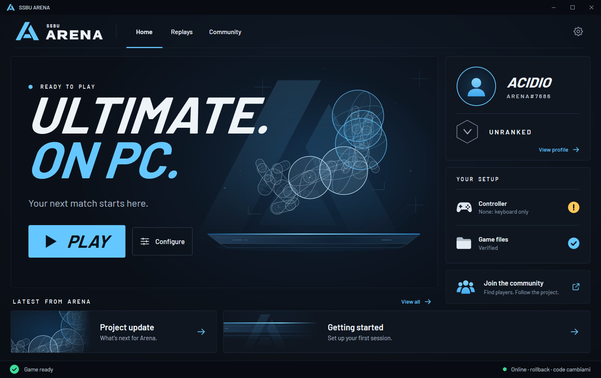

<div align="center">



# SSBU Arena

**Super Smash Bros. Ultimate on PC, built for competitive online play.**
Rollback netcode, matches through a relay server that never shows a player's address to another, a competitive 1v1
mode, and a launcher that sets it all up.

[](https://ssbuarena.com/)
[](LICENSE)


</div>

> **SSBU Arena is based on [OpenSmash-Ultimate (`Denkishi/ssbu-recomp`)](https://github.com/Denkishi/ssbu-recomp)** by
> Denkishi and its contributors: the static recompilation of the game, the runtime that replaces the console, the
> Vulkan renderer, the installer and the rollback snapshot ring all come from there. Arena started as a fork of it and
> is now developed on its own, because the two projects went in different directions. See [Credits](#credits).

> **This repository contains no game code, no game assets, no keys and no firmware.**
> You need your own legally obtained copy of the game (13.0.4 or 13.0.5). Everything derived from it is generated on
> your PC, from your dump, and never leaves it.

## What it is

The game's AArch64 code is translated to C ahead of time and compiled into a native Windows program (no emulation);
the console's system libraries, graphics, audio, input and files are re-implemented, and the picture is drawn with
Vulkan. That foundation is OpenSmash-Ultimate's. Arena builds a competitive online experience on top of it.

## What Arena adds

| Feature | State |
|---|---|
| **Online rollback** over our own relay lobby: Smash > Versus finds an opponent with the same friend code; same fight on both PCs in two-window tests through the server, with packet loss and jitter simulated | Working, tested on one PC with two windows |
| **Relay-only lobby server in C** (`tools/net/rb_lobby.c`): every packet goes through the server, no hole punching, no player ever learns another player's IP | Running on our server |
| **Local Wireless over the internet** through the same server (the game's own rooms and netcode) | Working |
| **Ping on screen** in every online match, next to each player (green, yellow, red) | Working |
| **Competitive mode**: six legal stages (Battlefield, Small Battlefield, Final Destination, Pokemon Stadium 2, Smashville, Town and City), no random items, no Final Smash meter, no hazards; modes outside the 1v1 blocked | Working |
| **Light archive**: only what the competitive 1v1 needs (8.8 of 16.4 GB) | Working |
| **SSBU Arena launcher** (`tools/launcher/arena`): Play, player profile, controller and game files state, settings for online, video, controllers, saves and DLC | Working |
| Friends and ranked matchmaking with an Elo rating | Planned |
| Replays | Planned |

## Install

1. Get the code: **Code > Download ZIP** on this page, or `git clone https://github.com/Acid236/ssbu-arena`.
2. Double-click **`Install SSBU.bat`**: a private Python inside the folder, a check of your PC, your keys and game
   found in the folders of the usual emulators, the update and DLC applied, the game files built on your PC.
   Arena does not publish a prebuilt runtime yet, so the runtime is compiled on your PC too: see
   **[BUILDING.md](BUILDING.md)** for what that needs.
3. Start **`build\Avvia SSBU.bat`**: it opens the SSBU Arena launcher (built by the setup when the .NET SDK is
   installed; otherwise the simpler PowerShell launcher opens). Choose a name, press **Play**.

Online: settings > Online. Players who use the same friend code find each other, in Local Wireless rooms and in
rollback matches (Smash > Versus). Empty code: public.

Full guide and the build done by hand: **[BUILDING.md](BUILDING.md)** (Linux: [BUILDING_LINUX.md](BUILDING_LINUX.md),
macOS: [BUILDING_MAC.md](BUILDING_MAC.md)). Online details: [docs/ONLINE.md](docs/ONLINE.md).

## How it works

```
your dump --> tools/extract --> main executable, SDK, script modules, data
                 |
        tools/lifter (recomp.py)     AArch64 -> C, one C function per game function
                 |
        clang --> game DLL + one DLL per script module
                 |
        runtime/                      what the console provided, re-implemented (threads, files, audio, input,
                                      movies, fonts, network), NVN graphics on Vulkan / OpenGL,
                                      rollback (r1_*.c, rb_*.c) and the online layer (net_relay.c)
```

## FAQ

**Is this legal?** The repository contains no game code, assets, keys or firmware, and does not help anyone obtain
them. You build the program on your PC from a copy of the game you own. This is not legal advice; laws differ by
country.

**Does it include the game?** No. Not the game, not the keys, not the firmware, and no links to them.

**Is my IP shared with the other player?** No. Every online packet goes through the Arena server; the other player only
sees a virtual address of the server's network.

## Credits

SSBU Arena is made by **[Acid236](https://github.com/Acid236)**: Local Wireless over the internet, the relay lobby
servers, online rollback through the relay, the ping overlay, the competitive mode and light archive, the launchers.

It exists because of **[OpenSmash-Ultimate / ssbu-recomp](https://github.com/Denkishi/ssbu-recomp)**.
Thank you to **Denkishi**, who created it and wrote most of it, and to its contributors: **Stephen Jayakar**,
**xtlg511**, **v1Ta44**, **Frank Fly**, **Victor Navega** and **jfb112697**. The full history of their work is kept in
this repository's git history. Details, and the open-source projects both projects build on, are in
**[CREDITS.md](CREDITS.md)**.

## Legal and license

SSBU Arena is not affiliated with, endorsed or sponsored by Nintendo, Bandai Namco or Sora Ltd. *Super Smash Bros.* and
*Nintendo Switch* are trademarks of their owners and are named only to say what the software works with. The
repository contains no copyrighted game data, no console keys and no firmware, and does not help anyone obtain them.
**You must own the game and dump it yourself.** No Nintendo logos or artwork are used.

Licensed under the GNU General Public License, version 3 or later, the same as OpenSmash-Ultimate (see
[LICENSE](LICENSE)). Files keep their original copyright and license notices.
